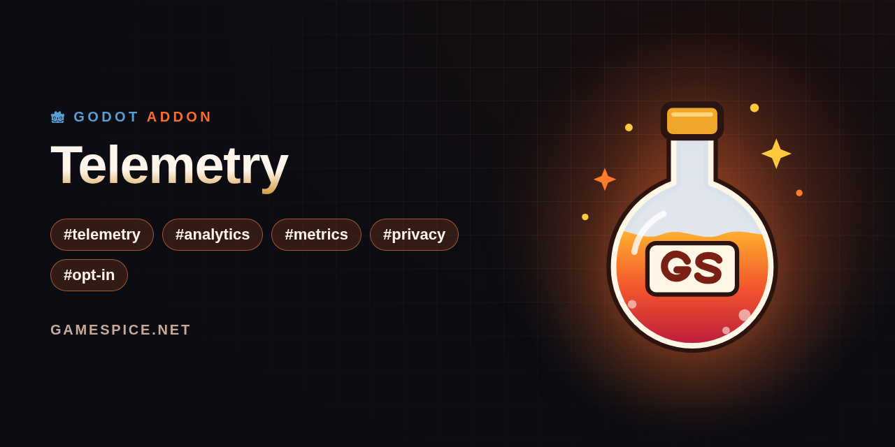

[](https://moddingcommunity.com/a/138-gs-telemetry)

Godot 4.7+ addon for opt-in gameplay and performance analytics: named events with a declared schema, session and funnel rollups, error and crash summaries, batched shipping to the TMC backbone, and an off switch the player controls. Part of the GameSpice addon family; needs only GameSpice Core.

Telemetry here is a small, honest pipe. You declare every event and field up front, nothing is recorded until telemetry is switched on, a field you did not declare cannot leave the game, and every queue has a bound you can see and change.

Unsent events survive a restart: `queue.to_array()` and `queue.load_array()` hand the waiting events to GameSpice Save or a file. After a failed send the wait before the next automatic flush doubles, up to `max_backoff_seconds` (0 keeps the interval), and a success resets it. The queue drops its oldest event by moving a head index, so a full queue costs no more per event than an empty one. The node also flushes when the game closes or is paused (`flush_on_exit`).

## Install

1. Copy `addons/dot_telemetry/` and `addons/dot_core/` into your project.
2. Enable GameSpice Telemetry in *Project > Project Settings > Plugins*.

## Quick start

```gdscript
var t := GSTelemetry.new()
t.config = GSTelemetryConfig.from_files().value   # layered cfg, env and flags
add_child(t)

t.schema.declare(&"level.finish", {"seconds": "float", "deaths": "int", "map": "string"})
t.rollup.define_funnel(&"onboarding", [&"tutorial.start", &"tutorial.move", &"level.finish"])

t.start_session(session_id)                 # sampling is decided once per session
t.set_enabled(player_opted_in)              # the player's switch; off discards what is unsent

var r := t.track(&"level.finish", {"seconds": 41.2, "deaths": 3, "map": "dust"})
if not r.ok:
    push_error(r.error.message)             # an undeclared event or field fails loudly

t.batch_ready.connect(func(batch): send_to_backbone(batch))   # your HTTP client ships it
t.shipped(ok, batch)                        # a failed batch goes back to the front of the queue
print(t.rollup.funnel(&"onboarding"), t.rollup.crash_free_rate())
```

## Settings

Every number is a field on `GSTelemetryConfig`. The values below are defaults, and the ranges are inspector slider limits, not enforced caps. Set the property from code or a config file to go beyond them.

| Setting | Default | What it does |
| --- | --- | --- |
| `enabled` | false | Master switch and the player's off switch. Off, nothing is recorded. |
| `endpoint` | empty | Where batches go. https, or http on localhost; checked by `validate()`. |
| `flush_seconds` | 30 | Seconds between batches while enabled. |
| `batch_size` | 100 | Events per batch; 0 sends the whole queue. |
| `max_queue` | 5000 | Events kept while waiting to ship; 0 is unlimited. The oldest is dropped and counted. |
| `sample_rate` | 1.0 | Share of sessions that report, picked once per session from its id. |
| `max_string` | 256 | Longest string property; 0 is unlimited. A longer one is refused, not cut. |
| `allow_unknown_events` | false | Record events the schema does not declare, as they are. |

Layers, weakest first: the defaults, `cfg/addon/dot_telemetry/*.yml`, the game's files, the operator's files, `DOT_TELEMETRY_*` environment variables, then `--telemetry-*` flags.

## What it is not

- Not per-player statistics: counters, bests and a pseudonymous player id that a game reports are GameSpice Stats. Telemetry is about how the game and the build behave, by session.
- Not a log sink: shipping log lines to files, syslog or a collector is GameSpice Log.
- Not a profiler: naming the cause of a frame spike is GameSpice Profiler. Telemetry can carry its summary as an event.
- Not an HTTP client: it queues and batches, and hands you the batch. Your game's client sends it.
- Not a way around consent: it never reads a device id, an address or a name on its own, and it records nothing until `enabled` is true.

## Test

```bash
godot --headless --path . --import
godot --headless --path . res://examples/telemetry_selftest.tscn
```

The self-test is offline and exits non-zero on any failure.

## Status

Built and maintained with Claude Code. The test suites pass, but little of this has been in front of real players yet. Please report rough edges by opening an issue.

## Licence

MIT. See [LICENSE](LICENSE). Only the TMC back-end web infrastructure is not open source.
